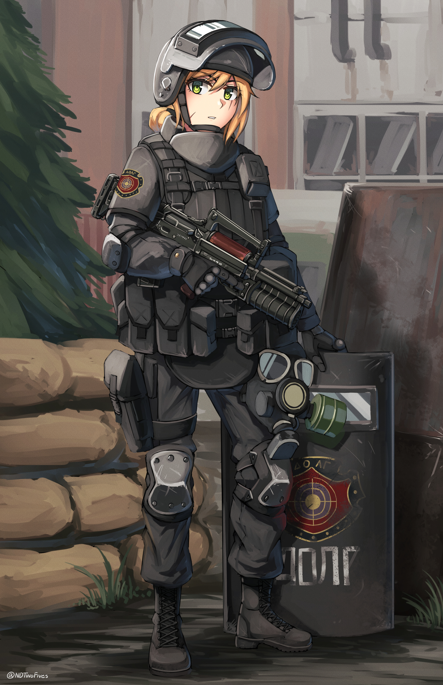

# Duty Expansion Redux

This repository is a refactoring of the original Duty Expansion mod for S.T.A.L.K.E.R: Anomaly created by 
https://github.com/GhenTuong
https://www.moddb.com/mods/stalker-anomaly/addons/duty-expansion


This redistribution consists of:
- Duty Expansion
- Spanish language support
- Russian language support
- Faction Based rewards patch, exposed via ltx config
- Hip/Anna co-companion setting, exposed via ltx config
- Various bug fixes, optimizations, and code quality improvements.
- Refactoring with DXML to remove conflicts with other mods

Betrayed by one of their own, losing territory, suffering casualties. Duty was once the most feared and respected clan of stalkers in the Zone, but now licking their wound in the shadow. Recovered from the downfall, battle-hardened and well equipped, what will Duty do to regain the reputation it once deserved?

Content:
- An unique character, Anna. She guards the Rostok entrance at day and stays around the campfire at night.
- New stalker settlement, a Duty outpost.
- A quest chain of 4 quests to unlock the Duty outpost and Anna as a companion.

## Installation:

### Requirements 
- Modded EXES https://github.com/themrdemonized/xray-monolith

### Instructions
Just install like a normal addon. Does not require a new game to enable. However, mid-playthrough removal is unsupported.  
If you have already enabled a different duty expansion version, do NOT replace it with this one mid-playthrough. It will corrupt your save.

## Configuration

### Companion Restriction
Anna and Hip cannot be companions simultaneously by default (this
matches the original mod's behavior). To allow both:

`gamedata/configs/scripts/squad_duty_girl.ltx`

```
    ltxallow_simultaneous_companions = true
```


### Faction-Based Loot Rewards
The loot_stash quest reward varies by the player's current faction.
Edit weapon, ammo, and consumable lists per faction in:

`gamedata/configs/misc/duty_girl_loot_stash.ltx`

Three sections — `[duty_girl_loot_weapons]`, `[duty_girl_loot_ammo]`,
`[duty_girl_loot_stuff]` — one key per faction, comma-separated values.
Weapon and ammo lists must be the same length per faction (they're
paired by position). Players will be awarded a random weapon from their faction's list and the corresponding ammo. 

## Changes in 0.1.1-beta
- Fixed Anna getting stuck crouched and untalkable after quest kills, which blocked the reward.
- Saves already stuck: leaving the level and returning does not fix them. Reload a save from before the kill.

## Credits 
- GhenTuong for the original mod.
- houston12346 for Russian translation
- NLTP_ASHES for original faction based rewards patch. 
- NDTwoFives for original Anna concept art.

